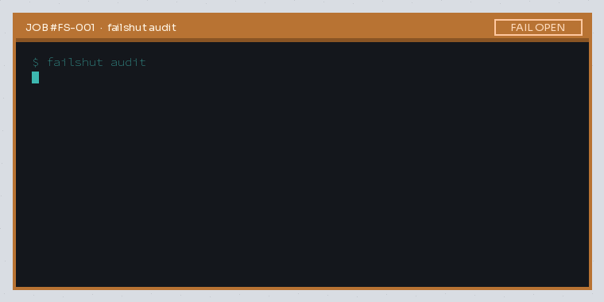

<p align="center">
  
</p>

# failshut

**Tell you, in one command, whether your AI coding-agent permission hooks and deny/ask rules actually fail shut — or silently fail open.**

You configured deny/ask/hooks for Claude Code, Codex, or OpenCode. After an upgrade, does policy still hold — or did a harness quirk turn it into a silent allow? `failshut audit` pressurizes the config manifold and reports every joint that bubbles.

Pain this comes from (see [Coverage](#coverage) for what v0.1 actually detects): [claude-code#32990](https://github.com/anthropics/claude-code/issues/32990) · [claude-code#102649](https://github.com/anthropics/claude-code/issues/102649) · [opencode#55728](https://github.com/anomalyco/opencode/issues/55728) · [opencode#55814](https://github.com/anomalyco/opencode/issues/55814) · [opencode#55909](https://github.com/anomalyco/opencode/issues/55909) · [codex#54298](https://github.com/openai/codex/issues/54298) · [codex#54440](https://github.com/openai/codex/issues/54440) · [codex#54448](https://github.com/openai/codex/issues/54448) · [claude-code#102582](https://github.com/anthropics/claude-code/issues/102582)

## Install

```bash
# Linux amd64 example — see Releases for darwin/windows + arm64
curl -sL https://github.com/Blackman99/failshut/releases/download/v0.1.0/failshut_0.1.0_linux_amd64.tar.gz | tar xz
./failshut audit
```

Or: `go install github.com/Blackman99/failshut/cmd/failshut@latest`

## Usage

```bash
failshut audit
failshut audit --project ~/code/my-app   # also scans <project>/.claude and opencode.json
failshut audit --json
failshut mcp          # read-only: audit_report, list_findings
```

Sample FAIL OPEN output:

```text
FAIL OPEN — 1 finding(s) where policy may not hold:

[1] hook-missing  (claude-code)
    file:     /home/you/app/.claude/settings.json
    evidence: PreToolUse command "\"$CLAUDE_PROJECT_DIR\"/.claude/hooks/block-src-writes.sh" runs /home/you/app/.claude/hooks/block-src-writes.sh — missing
    fix:      Restore the hook script or fix the path. A hook that cannot start exits non-2, and Claude Code lets the tool call through.

Summary: 1 FAIL OPEN · 5 FAIL SHUT checks · 1 config(s)
```



Exit `1` on any FAIL OPEN · `0` if sealed or nothing configured.

**v0.1 is static.** It does not intercept live tool calls (`--canary` → not in v0.1).

## Rules

| ID | Catches |
|---|---|
| `hook-missing` | Claude Code hook whose script is missing or not executable. The command is parsed like a shell would: `bash`/`sh`/`python3`/`node` prefixes, quotes, `~`, `$HOME`, `"$CLAUDE_PROJECT_DIR"/…`. Nothing is executed. |
| `deny-ignored` | OpenCode `read`/`edit` deny/ask rule the runtime never matches: a `./`-prefixed resource, or an absolute resource inside the project |
| `delegation-escalate` | OpenCode agent (incl. `plan`) that denies edit but can still launch the write-capable `general` subagent |
| `path-traversal-config` | `..` in `--project` or OpenCode path fields that can load a sibling config |
| `ask-vs-effective` | Heuristic Codex approval/sandbox mismatches (see Coverage) |
| `ask-auto-allow` | Heuristic hook-ask + auto-allow pairing (see Coverage) |

## Coverage

What v0.1 detects from config alone, issue by issue. Being honest here is part of the product.

| Issue | Status | Notes |
|---|---|---|
| [claude-code#32990](https://github.com/anthropics/claude-code/issues/32990) | **Detected** | `hook-missing`: settings still point at a deleted hook script. Fixture `testdata/hook-missing-32990`. |
| [claude-code#102649](https://github.com/anthropics/claude-code/issues/102649) | **Detected after the fact** | `hook-missing` flags `bash ~/.claude/hooks/x.sh` once the script is gone. It cannot see the race that deleted it. Fixture `testdata/hook-missing-102649`. |
| [opencode#55728](https://github.com/anomalyco/opencode/issues/55728) | **Detected** | `deny-ignored`: the reported `./`-prefixed resource. A plain `"read": "deny"` works and is not flagged. |
| [opencode#55814](https://github.com/anomalyco/opencode/issues/55814) | **Detected when the agent is configured** | `delegation-escalate`, v2 `agents.<name>.permissions` form. An OpenCode install with no `agents` block at all is not flagged. |
| [opencode#55909](https://github.com/anomalyco/opencode/issues/55909) | Partial | Only `..` in `--project` or config path fields. The reported trigger is a `..` directory passed to the server API, which config cannot show. |
| [codex#54298](https://github.com/openai/codex/issues/54298) | Not detected | Codex's `granular.sandbox_approval = false` auto-*rejects* requests. That fails shut, so it is not reported as FAIL OPEN. |
| [codex#54440](https://github.com/openai/codex/issues/54440) | Not detected | Windows runtime bug; nothing in config shows it. |
| [codex#54448](https://github.com/openai/codex/issues/54448) | Not detected | Delegation policy is chosen by the service, not by a local config key. |
| [claude-code#102582](https://github.com/anthropics/claude-code/issues/102582) | Not detected | Hook `ask` answered in desktop auto mode; not decidable from settings files yet. |

## Docs & site

https://blackman99.github.io/failshut/ · [docs](https://blackman99.github.io/failshut/docs/)

## License

MIT
